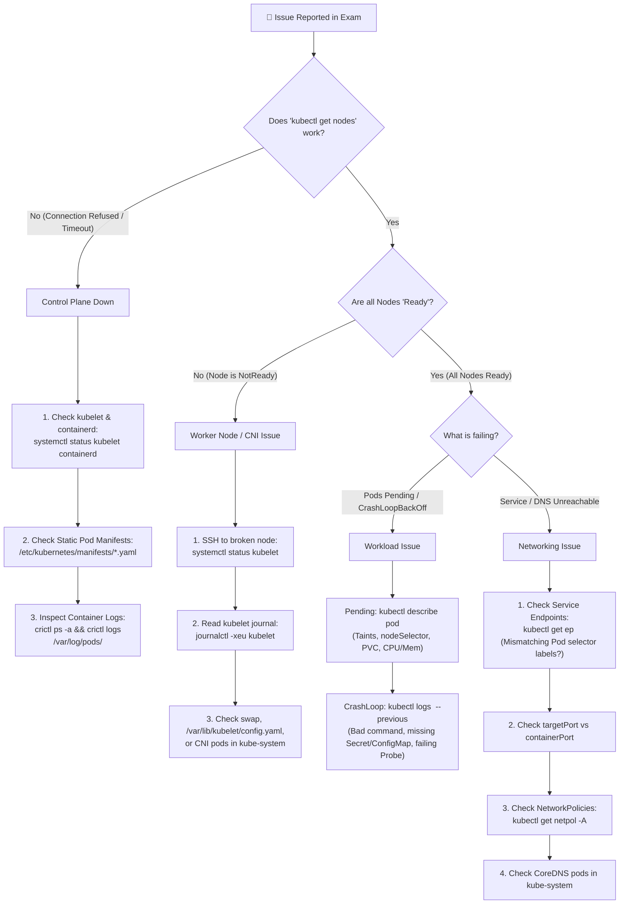

# Domain 5: Troubleshooting (30% of CKA) & Interactive Break-Fix Lab

[⬅ Back to Main CKA Hub](../Readme.md)

**Troubleshooting is the single largest domain on the CKA exam (30%).** Because you built a real multi-node `kubeadm` cluster on Ubuntu VMs, you can practice breaking and fixing the exact same components tested in the exam.

---

## 1. Systematic CKA Troubleshooting Flowchart



---

## 2. Interactive "Break & Fix" Practice Scenarios

Each scenario folder contains:
- **`break.sh`**: Run this script to inject a realistic CKA exam failure into your cluster without peeking at what it changed.
- **`verify.sh`**: Run this script after you think you've fixed the issue—it grades your work (`PASS ✅` or `FAIL ❌`).
- **`SOLUTION.md`**: Step-by-step diagnosis and fix if you get stuck.
- **`fix.sh`**: ⚠️ *Spoiler.* The `SOLUTION.md` fix as a script. It exists so the scenarios can test themselves ([section 4](#4-how-the-scenarios-test-themselves-ci)). Don't run it while practicing.

> **💡 Before You Start:** Make sure you have a clean VMware Snapshot of `k8s-master` and `k8s-worker`, or always run `verify.sh` before moving to the next scenario!

| Scenario | CKA Topic Tested | Where to Run `break.sh` | Difficulty |
| :--- | :--- | :--- | :--- |
| [**Scenario 01: Worker Node `NotReady`**](./scenario-01-worker-notready/SOLUTION.md) | `systemd`, `kubelet` config, node recovery | Run on **`k8s-worker`** | ⭐⭐ |
| [**Scenario 02: Control Plane API Server Down**](./scenario-02-apiserver-down/SOLUTION.md) | Static Pods (`/etc/kubernetes/manifests`), `crictl`, `etcd` port debugging | Run on **`k8s-master`** | ⭐⭐⭐ |
| [**Scenario 03: Service & NetworkPolicy Blackhole**](./scenario-03-network-blackhole/SOLUTION.md) | Service selectors, `Endpoints`, Calico `NetworkPolicy` | Run on **`k8s-master`** | ⭐⭐⭐ |
| [**Scenario 04: Stuck Workloads (`Pending` & `CrashLoopBackOff`)**](./scenario-04-pending-and-crashloop/SOLUTION.md) | Node scheduling (`nodeSelector`/Taints), container args, `livenessProbe` | Run on **`k8s-master`** | ⭐⭐ |

---

## 3. How to Run a Scenario

```bash
# Example: Running Scenario 02 on k8s-master
cd ~/k8s-homelab/05-troubleshooting-break-fix/scenario-02-apiserver-down

# 1. Break the cluster
chmod +x break.sh verify.sh
./break.sh

# 2. Diagnose and fix the issue using your CKA skills!

# 3. Grade your solution
./verify.sh
```

> **kind path:** ⚠️ Scenarios 03 and 04 run from your WSL terminal exactly as shown. Scenarios 01 and 02 break a node, so copy the scenario into the node container and run it there as root:
> ```bash
> # Scenario 01 (worker node)
> docker cp scenario-01-worker-notready k8s-worker:/root/
> docker exec -it -w /root/scenario-01-worker-notready k8s-worker bash   # then ./break.sh ... ./verify.sh
>
> # Scenario 02 (control plane). Inside the node, kubectl needs the admin kubeconfig
> docker cp scenario-02-apiserver-down k8s-control-plane:/root/
> docker exec -it -e KUBECONFIG=/etc/kubernetes/admin.conf -w /root/scenario-02-apiserver-down k8s-control-plane bash
> ```
> Snapshot equivalent: `kind delete cluster --name k8s` and then recreate it ([kind/README.md](../kind/README.md)).

> **kind shortcut with [Task](https://taskfile.dev):** From the repo root, `task break S=1` and `task verify S=1` do the `docker cp` / `docker exec` steps above for you, and work the same for every scenario. You still diagnose the problem by hand, for example with `docker exec -it k8s-worker bash`. See the [`Taskfile.yml`](../Taskfile.yml) for exactly what each shortcut runs.

---

## 4. How the Scenarios Test Themselves (CI)

A break-fix lab can go stale without anyone noticing. A new Kubernetes release might deprecate an API that `verify.sh` uses (this already happened: the v1 `Endpoints` API was deprecated in 1.33, so Scenario 03 now reads `EndpointSlices`). An upstream manifest URL can move, or a typo in `break.sh` can mean nothing breaks at all. To catch all of these, the [GitHub Actions workflow](../.github/workflows/scenarios.yml) builds the kind cluster and runs every scenario through four steps:

| Step | What runs | What it proves |
| :--- | :--- | :--- |
| 1 | `break.sh` | The failure can still be injected |
| 2 | `verify.sh` **must FAIL** | The grader notices the breakage. A grader that always passes would teach you nothing |
| 3 | `fix.sh` | The `SOLUTION.md` fix still applies on the current Kubernetes version |
| 4 | `verify.sh` **must PASS** | That fix is really what the grader checks for |

Step 2 is the one people usually skip. It's called *testing the test*: if you only ever check the happy path, a broken grader looks exactly like a passing student.

Two details are worth knowing for the exam as well:
- **Kubernetes is eventually consistent.** After you edit a static pod manifest, kubelet needs about 20 seconds to recreate the pod, and a rollout takes time to finish. So [`scripts/scenario.sh`](../scripts/scenario.sh) re-runs `verify.sh` every 5 seconds, for up to 3 minutes, instead of checking once. In the exam, wait and re-check before you decide a fix didn't work.
- **It runs every Monday**, even when nothing in this repo changed, because the things that break these labs (node images, Calico manifests, API deprecations) change upstream.

Run the same self-test locally on your kind cluster:
```bash
task test        # all scenarios (about 5 minutes)
task test S=2    # just one
```

---

🎓 **That's the whole course.** To get exam-ready:
- Re-run all four scenarios against a timer. Aim for under 10 minutes each, without opening `SOLUTION.md`.
- If you studied on kind, build [Path A](../vm/README.md#1-infrastructure-setup) at least once to practice the VM-only parts (OS prep, `kubeadm upgrade`, the full `etcd` restore).
- Go back over the [cheatsheet](../cheatsheets/cka-exam-day-survival-guide.md) until the first-60-seconds setup is automatic.

⬅ **Previous:** [Domain 4: Storage](../04-storage/README.md) · [⬆ CKA Study Hub](../Readme.md#cka-study-hub--hands-on-lab-modules)
